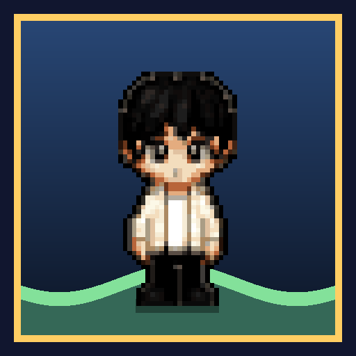
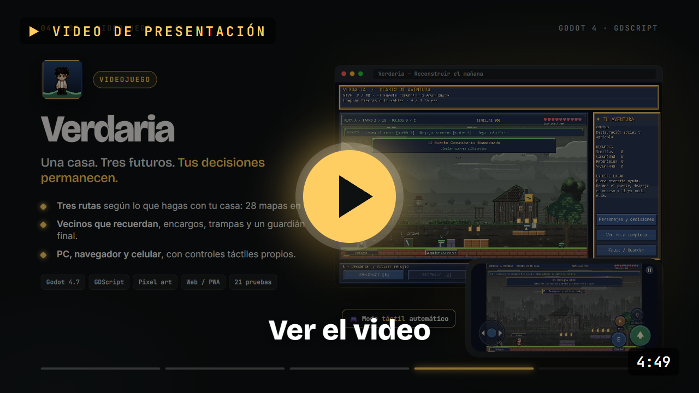
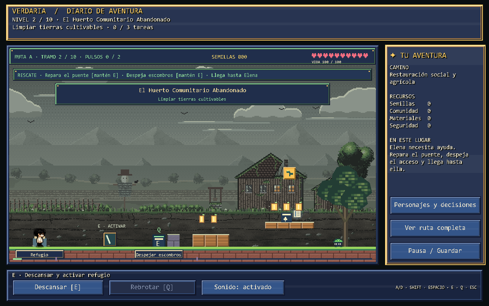
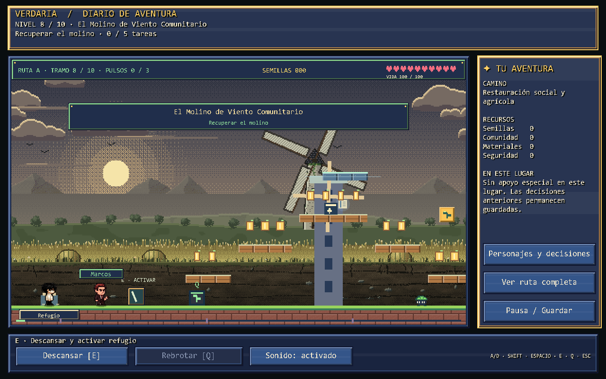
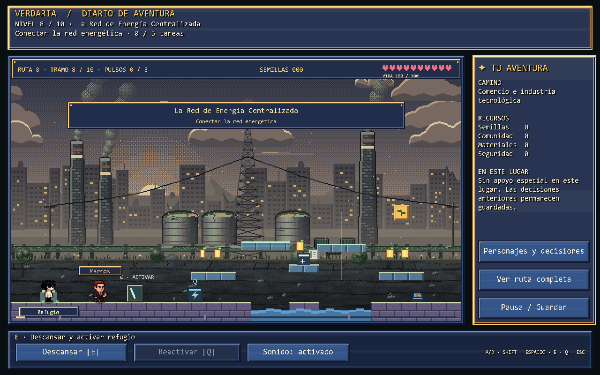
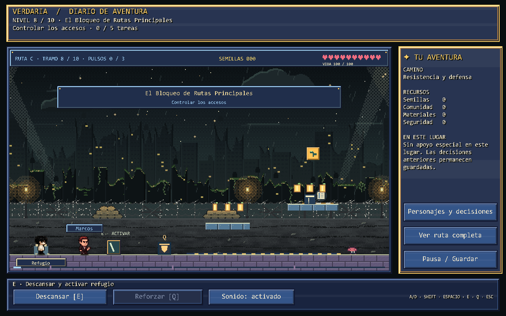
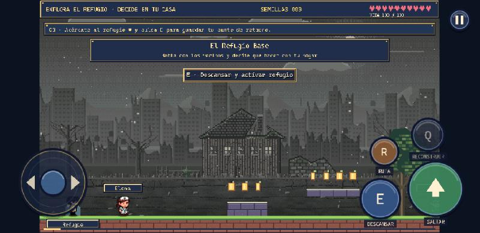

<p align="center">
  
</p>

<h1 align="center">Verdaria — Reconstruir el mañana</h1>

<p align="center">
  Aventura de plataformas en 2D con arte pixelado, hecha en <b>Godot 4.7</b>.<br>
  Una casa. Tres futuros. Tus decisiones permanecen.
</p>

## 🎬 Video de presentación (4:49)

[](video/Verdaria_presentacion.mp4)

**[▶ Ver el video de Verdaria](video/Verdaria_presentacion.mp4)**: qué problema resuelve, qué hace, una demo, la arquitectura, la calidad y los aprendizajes. Narrado por Nicoll Valentina.

<p align="center">
  
</p>

## El juego

Empiezas en un refugio en ruinas. Lo que decidas hacer con tu casa fija una de tres rutas, y cada una tiene nueve lugares propios:

| Rama | Decisión en la casa | Estilo de los niveles |
| --- | --- | --- |
| **A · Restauración** | Limpiar y reparar | Huertos, acueductos, bosques; las pasarelas rebrotan y curan |
| **B · Industria** | Vender y desguazar | Fundiciones, talleres, laboratorios; las pasarelas apagan trampas |
| **C · Defensa** | Abandonar y fortificar | Puestos, búnkeres, murallas; las pasarelas crean puntos de retorno |

- **28 mapas**: un refugio compartido y 27 niveles de campaña, de 3360 a 4640 px de ancho.
- Encargos, vecinos con confianza propia, decisiones narrativas con consecuencias y un guardián final.
- Semillas, cápsulas doradas, núcleos de reconstrucción, rutas elevadas, recuerdos ocultos.
- Peligros: pinchos, sierras, vapor con aviso, agua profunda, lava, cintas y plataformas móviles.
- Guardado automático versionado (v6), con migración de partidas antiguas.

<p align="center">
  
  
  
</p>

## Plataformas

| Plataforma | Cómo se juega |
| --- | --- |
| **Windows (Godot)** | `comandos/Jugar Verdaria.cmd` o abrir `juego/project.godot` y pulsar F5 |
| **Navegador en PC** | `comandos/Exportar Web.cmd` y luego `comandos/Jugar Web (PC).cmd` |
| **App de escritorio** | `app/Verdaria.vbs`: ventana propia con icono, sin barras del navegador |
| **iPhone / Android** | Versión web publicada con HTTPS → Safari → *Añadir a pantalla de inicio* |

En celulares y tabletas el juego cambia solo a **modo táctil**: ocupa toda la pantalla y muestra un mando y botones con el estilo del juego.

<p align="center">
  
</p>

## Controles

| Acción | Teclado | Mando | Táctil |
| --- | --- | --- | --- |
| Caminar | A/D o ←/→ | Stick / cruceta | Mando izquierdo |
| Correr | Shift | RB | Mando al borde |
| Saltar (mantener = más alto) | Espacio / W / ↑ | A | SALTAR |
| Hablar, usar, mantener para reparar | E | X | E |
| Paso seguro (3 semillas) | Q | Y | Q |
| Ruta elevada (5 semillas) | R | LB | R |
| Pausa | Esc | Start | ⏸ arriba a la derecha |
| Pantalla completa | F11 | — | — |

## Estructura del repositorio

```
.
├── juego/                  Proyecto de Godot (abrir project.godot)
│   ├── scenes/             Escena principal
│   ├── scripts/            Toda la lógica del juego (GDScript)
│   ├── shaders/            Filtro de monitor retro y gradación de paisajes
│   ├── personajes/         Sprites de la protagonista, Elena, Ivo y Marcos
│   ├── paisajes/           Fondos en capas de los 28 mapas
│   ├── fonts/              Cascadia Mono (OFL) para web y móvil
│   ├── web/                Plantilla HTML de carga e iconos de la app web
│   ├── tests/              21 pruebas automáticas y capturas
│   ├── tools/              verify.py (QA) y make_icons.gd
│   └── export_presets.cfg  Exportación web (PWA, sin hilos)
├── app/                    Lanzador de Windows (Verdaria.vbs) e icono .ico
├── comandos/               Atajos .cmd: jugar, verificar, exportar
├── docs/                   Arquitectura, diseño, revisiones y capturas
└── video/                  Video de presentación (4:49)
```

Las carpetas `export/`, `juego/build/` y `juego/.godot/` se generan en tu PC y no se suben.

## Desarrollo

**Requisitos:** Godot 4.7.2 (renderizador Compatibility) y Python 3 para las pruebas y el servidor local.

```bash
# Pruebas de jugabilidad (12 suites sin ventana)
python juego/tools/verify.py

# Además, capturas y medición de rendimiento
python juego/tools/verify.py --visual
```

Si Godot no está en el `PATH`, define la variable `GODOT` con la ruta de `Godot_v4.7.2-stable_win64_console.exe`. Los `.cmd` de `comandos/` la buscan solos.

**Exportación web:** necesita las plantillas web de Godot 4.7.2. Es sin hilos, así que funciona en cualquier hosting estático sin cabeceras especiales.

## Documentación

- [Arquitectura del código](docs/ARQUITECTURA.md): cómo encajan los sistemas, con un análisis del código.
- [Guía del juego](docs/GUIA_DEL_JUEGO.md): mecánicas, mapas y pruebas en detalle.
- [Diseño y cambios v2](docs/DISENO_Y_CAMBIOS_V2.md): medidas, reglas e inventario de mapas.
- [Revisión de producción](docs/REVISION_PRODUCCION.md): controles, cámara, combate y QA.
- [Web y móvil](docs/WEB_Y_MOVIL.md): publicar la versión web e instalarla en el iPhone.

## Licencias de terceros

- **Cascadia Mono** © Microsoft, SIL Open Font License 1.1 (`juego/fonts/LICENCIA.txt`).
- **Godot Engine**, licencia MIT.
